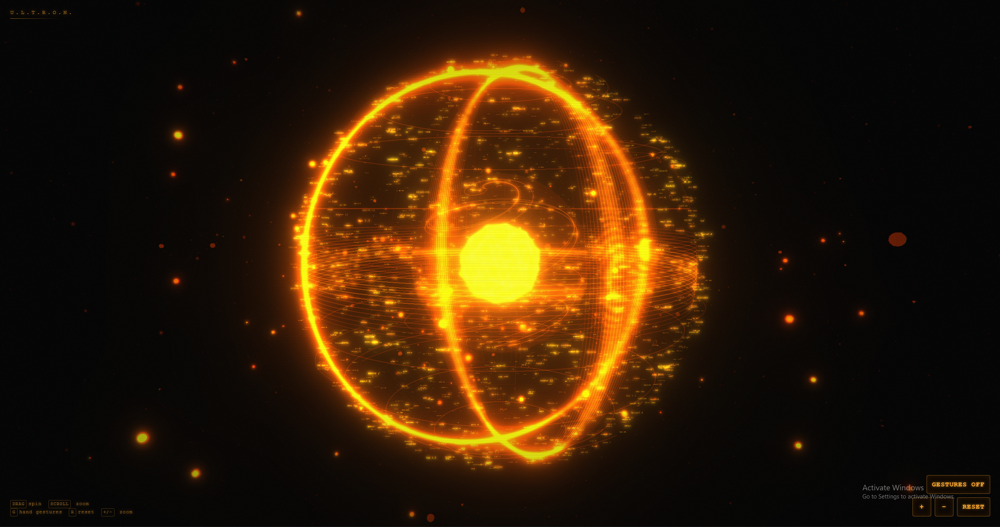

# ULTRON Orb UI

**Project presentation by C. Karnesh Raja**  
First-year student, Department of Artificial Intelligence & Data Science  
SRM Valliammai Engineering College

## About this project

ULTRON Orb UI is an Iron Man–inspired interactive holographic orb interface. It is built with **Next.js**, **Three.js**, and **MediaPipe** hand tracking, and can be controlled with a mouse, touch, keyboard, or webcam-based hand gestures.

I am a first-year student exploring artificial intelligence, software development, and interactive interfaces. I prepared this project README to present the features and setup of the ULTRON Orb UI project as part of my learning. The original ULTRON project and its underlying work are credited to their respective creators; this interface should not be mistaken for an AI system created entirely by me.

> ULTRON is described by its original creator as an open-source interface for an AI assistant. Learn more in the [original project write-up](https://sagartamang.com/projects/ultron) and [project post](https://x.com/sagar_builds/status/2077277583646101921).

> [Watch the demo on Instagram](https://www.instagram.com/p/DayJ17OTwvx/)



https://github.com/user-attachments/assets/91578a83-9a27-44e8-84b0-96defcfd7366

## Getting started

Install the dependencies and start the development server:

```bash
npm install
npm run dev
```

Then open [http://localhost:3000](http://localhost:3000).

## Controls

### Mouse and touch

| Input | Action |
| --- | --- |
| Drag | Spin the orb |
| Scroll or pinch | Zoom in and out |

### Hand gestures (webcam)

Click **GESTURES OFF** (or press `G`) and allow camera access.

| Gesture | Action |
| --- | --- |
| Pinch thumb and index finger with one hand, then move | Spin the orb |
| Pinch with both hands and spread them apart or bring them together | Zoom in or out |

### Keyboard

| Key | Action |
| --- | --- |
| `G` | Toggle hand gestures |
| `T` | Show or hide the text and chat panel (use its × button to close) |
| `R` | Reset the view |
| `+` / `−` | Zoom in or out |

## Voice assistant features

Create `.env.local` from `.env.local.example` and add your `GEMINI_API_KEY`. Start the app with `npm run dev`, then open it in **Chrome or Edge**.

| Feature | Example |
| --- | --- |
| **Wake word** | Click **WAKE WORD** (or press `W`), allow microphone access, then say “Hey ULTRON, what time is it?” |
| **Time and date** | “What time is it?” or “What's today's date?” |
| **Timers and reminders** | “Set a timer for 5 minutes,” “Remind me in 10 minutes to call mom,” “How much time is left?” |
| **Notes** | “Take a note: demo is on Friday,” “Show my notes,” or “Delete the last note” |
| **To-do list** | “Add buy milk to my to-do list,” “Show my to-do list,” or “Mark todo 2 as done” |
| **Open apps and websites** | “Open WhatsApp,” “Open Spotify,” or “Search for python decorators on YouTube.” Supported sites are listed in `lib/sites.ts`. |
| **Project docs search** | “Search the docs for gestures” searches `README.md`, `/knowledge`, and `/docs`. |
| **Conversation memory** | Ask a follow-up such as “Explain that with another example.” Say “Clear history” to reset. |
| **Orb states** | Idle (amber), listening (blue), thinking (fast spin), speaking (pulses per word), error (red), and paused (dim). |
| **Orb colors** | Choose orange, blue, violet, teal, or rose from the color menu beside the ULTRON title. |
| **Gesture actions** | Hold an open palm for about one second to pause or resume. Swipe an open hand left or right to change panels. Zoom into the core, then hold three fingers up on your left hand and pinch with your right hand to show app shortcuts. Hold the right-hand pinch cursor over an icon for 4.5 seconds to open it. |

Other shortcuts: `P` pause, `W` wake word, `G` gestures, `T` text panel, and `R` reset view.

### Known limits

- Wake word detection uses browser speech recognition. It works in Chrome and Edge, needs internet access, and requires the tab to stay open; it is not an offline always-on hot-word engine.
- Voice commands open supported web versions of apps in a new tab. A browser cannot launch arbitrary installed desktop apps. Add web shortcuts in `lib/sites.ts` to support more web apps.
- Notes, to-dos, timers, and chat history are stored in this browser's `localStorage`. Timers stop if the tab is closed.
- Documentation search checks only `README.md`, `/knowledge`, and `/docs` in the project. It uses keyword matching rather than semantic search.

## How it works

- **`lib/orbScene.ts`** — Three.js scene with layered wireframe shells, a spiral inner core, floating code-text sprites, orbiting debris, dust particles, scan rings, and bloom and chromatic-aberration post-processing.
- **`lib/handTracker.ts`** — MediaPipe HandLandmarker runs on the webcam feed. One pinched hand spins the orb; two pinched hands zoom by moving apart or together.
- **`components/JarvisOrb.tsx`** — HUD and connections between the scene, tracker, voice, chat memory, and user input.
- **`lib/assistant.ts`** — Local command router for time, timers, notes, to-dos, websites, and documentation search.
- **`app/api/agent/route.ts`** — Gemini function-calling endpoint with bounded tool steps for documentation search, time, notes, to-dos, and timers. Personal data tools execute in the current browser and keep using its local storage.
- **`lib/wakeWord.ts`** — “Hey ULTRON” listener built on the Web Speech API.
- **`app/api/chat/route.ts`** — Gemini proxy with model fallback and conversation history.
- **`app/api/docs/route.ts`** — Keyword search over project documentation.

## Updates in this build

- Gesture callbacks avoid redundant pointer state updates and stop cleanly when the component unmounts or camera startup is cancelled.
- Push-to-talk is available from the always-visible controls as **MIC INPUT**.
- The **STUDY** panel accepts a FEN position and opens Lichess analysis for post-game study.

## Chess mode

Open the text panel and select the **CHESS** tab (or say or type an action that opens it). Chess opens in a dedicated full-window view. The orb HUD, gesture camera, wake word, microphone, and voice controls are hidden and switched off while you play. The board adapts to the window size: wide windows show the board with a side panel, while narrow or half-screen windows stack them.

- Choose **WHITE** or **BLACK**, select **EASY / MEDIUM / HARD**, click a piece, then click a highlighted square.
- **HINT** highlights the engine's suggestion, **UNDO** takes back your last move, and **NEW GAME** restarts.
- Includes hand-drawn SVG pieces, move animation, check highlighting, captured pieces and material lead, an evaluation bar, and a move list.
- The theme button switches between orange and blue. Select **EXIT CHESS** or press `Esc` to return to ULTRON. The game is saved in this browser.
- Orb shortcuts such as `G`, `W`, `P`, and `T` are disabled while chess is open.

Chess code: `lib/chess/engine.ts` (rules and search, no dependencies), `lib/chess/worker.ts` (runs search in a Web Worker), `components/ChessPanel.tsx` (board UI), and `components/chessPieces.tsx` (SVG piece set).

